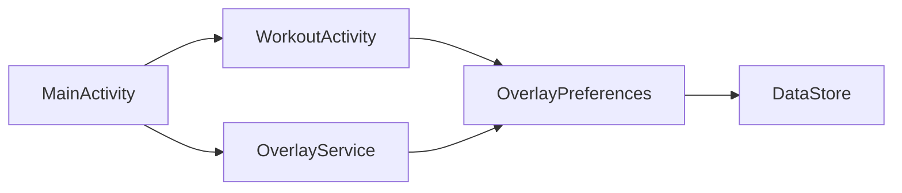

# Architecture Overview
MainActivity launches WorkoutActivity or starts OverlayService after overlay permission is granted. Both editing surfaces use OverlayPreferences, TouchAwareFrameLayout, StrokeTextView, SelectionDebugLogger and constants/AppMagicNumbers. Source files are under app/src/main/java/com/example/workouttimer. Layouts are under app/src/main/res/layout. AndroidManifest.xml registers components.

## Example
- Input: User presses Dev Mode.
- Steps: MainActivity launches WorkoutActivity.
- Expected result: Editing opens inside the app.

- [Design](../design/workout/10-edit-mode.md)
- [Data Flow](20-data-flow.md)
