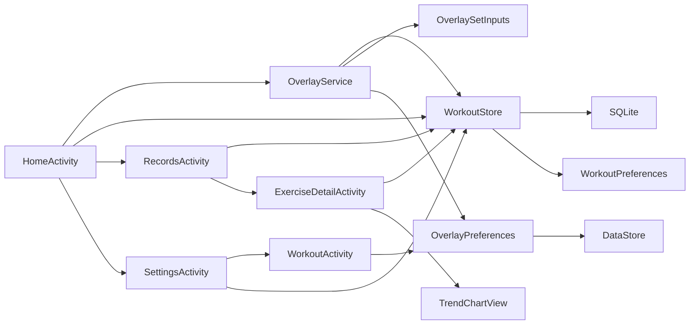

# Architecture Overview
HomeActivity in the ui package is the launcher. Home, Session, Records and ExerciseDetail read data/WorkoutStore for persistent session drafts and sets in SQLite. Settings uses persistent preferences and writes isolated test records through that store. Records opens ExerciseDetailActivity, which draws TrendChartView and compares a selected workout with its predecessor. Home START creates or resumes the draft and starts OverlayService. OverlaySetInputs provides the exercise picker, set target and load editor. OverlayService reads and writes the draft through WorkoutStore. Settings LAYOUT opens WorkoutActivity. Both editing surfaces use OverlayPreferences, TouchAwareFrameLayout, StrokeTextView, SelectionDebugLogger and constants/AppMagicNumbers. Source files are under app/src/main/java/com/example/workouttimer. Layouts are under app/src/main/res/layout. AndroidManifest.xml registers components.

## Example
- Home START opens the floating timer. Start a set, choose bcpr and enter 60 kg. Start rest persists the load and frozen rest through WorkoutStore.

- [Design](../design/workout/10-edit-mode.md)
- [Data Flow](20-data-flow.md)
