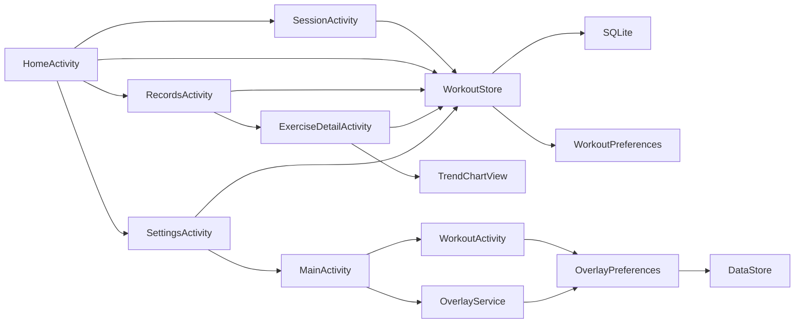

# Architecture Overview
HomeActivity in the ui package is the launcher. Home, Session, Records and ExerciseDetail read data/WorkoutStore for persistent session drafts and sets in SQLite. Settings uses persistent preferences and writes isolated test records through that store. Records opens ExerciseDetailActivity, which draws TrendChartView and compares a selected workout with its predecessor. Settings opens MainActivity. MainActivity launches WorkoutActivity or starts OverlayService after overlay permission is granted. Both editing surfaces use OverlayPreferences, TouchAwareFrameLayout, StrokeTextView, SelectionDebugLogger and constants/AppMagicNumbers. Source files are under app/src/main/java/com/example/workouttimer. Layouts are under app/src/main/res/layout. AndroidManifest.xml registers components.

## Example
- Input: User opens Lift Log and taps SETTINGS, then Overlay timer, then Dev Mode.
- Steps: HomeActivity opens SettingsActivity, which opens MainActivity, which launches WorkoutActivity.
- Expected result: Editing opens inside the app.

- [Design](../design/workout/10-edit-mode.md)
- [Data Flow](20-data-flow.md)
