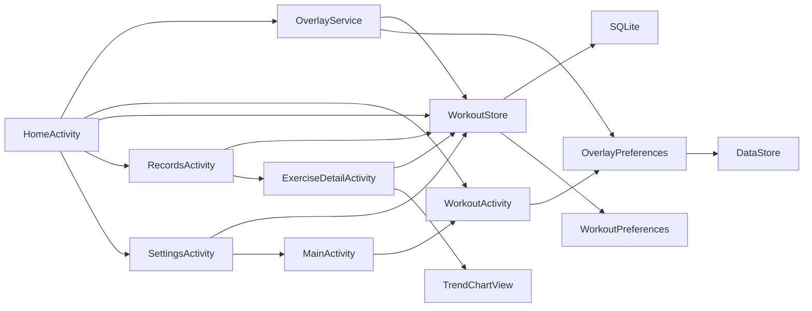

# Architecture Overview
HomeActivity in the ui package is the launcher. Home, Session, Records and ExerciseDetail read data/WorkoutStore for persistent session drafts and sets in SQLite. Settings uses persistent preferences and writes isolated test records through that store. Records opens ExerciseDetailActivity, which draws TrendChartView and compares a selected workout with its predecessor. Home START stores the chosen exercise, weight and reps in the draft and starts OverlayService, which reads and writes that draft through WorkoutStore. Home LAYOUT opens WorkoutActivity. Settings opens MainActivity, which keeps Dev Mode, layout reset and debug log tools. Both editing surfaces use OverlayPreferences, TouchAwareFrameLayout, StrokeTextView, SelectionDebugLogger and constants/AppMagicNumbers. Source files are under app/src/main/java/com/example/workouttimer. Layouts are under app/src/main/res/layout. AndroidManifest.xml registers components.

## Example
- Input: User opens Lift Log, enters bcpr, 60 kg and 10 reps and taps START.
- Steps: HomeActivity saves the draft through WorkoutStore and starts OverlayService.
- Expected result: The overlay timer floats above other apps and REST saves sets to WorkoutStore.

- [Design](../design/workout/10-edit-mode.md)
- [Data Flow](20-data-flow.md)
