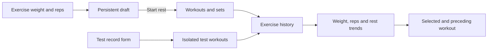
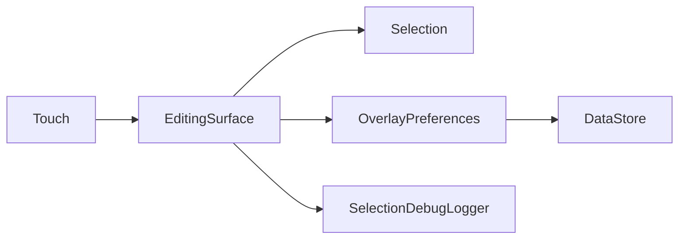

# Data Flow
HomeActivity starts or resumes the draft. OverlayService persists timer state and set inputs through WorkoutStore. Start rest writes the set and advances the draft to the rest phase in one SQLite transaction. The records table updates individual cells within the selected dataset. Weights are normalized to kg and an omitted repetition count is stored as SQL NULL. WorkoutStore persists the exercise catalog and per-exercise repetition counts in preferences. A dataset flag separates real and test workouts. Monotonic elapsed time tracks rest across backgrounding; boot count enables a wall time fallback after reboot.

Home and Records summarize the selected dataset. ExerciseDetail filters sets by exact exercise name and sorts workouts chronologically. ExerciseTrend calculates each workout’s average weight, repetitions and rest, plus percentage changes for the chart. A chart tap or dropdown selection displays the actual averages and compares the selected sets with the preceding workout. Records saves chart spacing. Debug settings manage the isolated test dataset.

Touch events update selection and element transforms in the editing surface. OverlayPreferences persists layout values in Preferences DataStore. SelectionDebugLogger sends diagnostics to Logcat and an internal file.

## Example
- Input: A saved element position is requested.
- Steps: Read element X and Y preferences.
- Expected result: A coordinate pair is returned if both exist, otherwise null.

- [Overview](10-overview.md)
- [Design](../design/workout/10-edit-mode.md)
