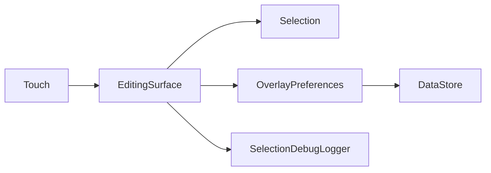

# Data Flow
Touch events update selection and element transforms in the editing surface. OverlayPreferences persists layout values in Preferences DataStore. SelectionDebugLogger sends diagnostics to Logcat and an internal file.

## Example
- Input: A saved element position is requested.
- Steps: Read element X and Y preferences.
- Expected result: A coordinate pair is returned if both exist, otherwise null.

- [Overview](10-overview.md)
- [Design](../design/workout/10-edit-mode.md)
