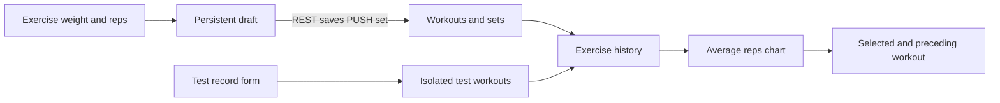
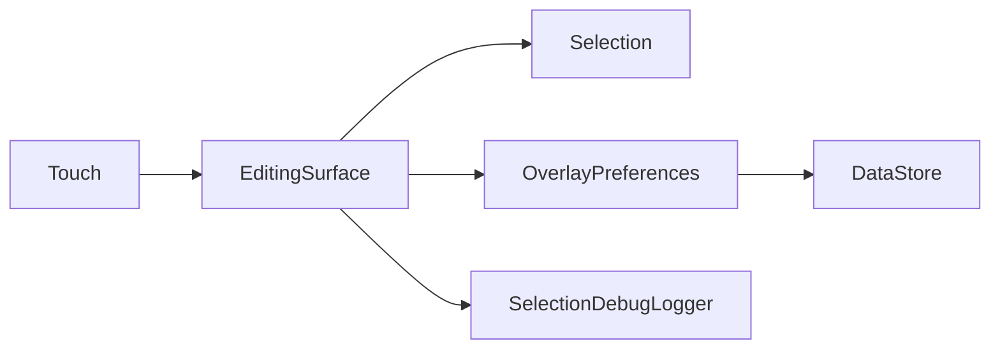

# Data Flow
SessionActivity persists draft inputs and REST or PUSH state through WorkoutStore. REST saves a completed set and next draft atomically in SQLite. A dataset flag separates real and test workouts. Monotonic elapsed time tracks rest across backgrounding; boot count enables a wall time fallback after reboot.

Home and Records summarize the selected dataset. ExerciseDetail filters sets by exact exercise name and sorts workouts chronologically, then supplies per workout mean repetitions and local day offsets to TrendChartView. A graph tap or dropdown selection chooses a workout and compares its sets with the preceding workout. Settings persists graph spacing and test mode, and writes or deletes only test records.

Touch events update selection and element transforms in the editing surface. OverlayPreferences persists layout values in Preferences DataStore. SelectionDebugLogger sends diagnostics to Logcat and an internal file.

## Example
- Input: A saved element position is requested.
- Steps: Read element X and Y preferences.
- Expected result: A coordinate pair is returned if both exist, otherwise null.

- [Overview](10-overview.md)
- [Design](../design/workout/10-edit-mode.md)
