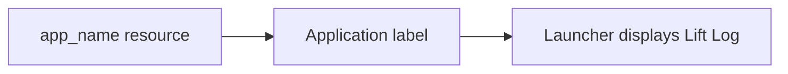

# App Identity
## Inputs And Outputs
- Input: Android application label resolution.
- Output: Lift Log.
- Code: app/src/main/res/values/strings.xml defines app_name; app/src/main/AndroidManifest.xml uses that resource for the application label.
- README.md uses the same product name. The existing application identifier and Gradle root name retain their existing values.

## Example
- Input: Launcher resolves the application label.
- Steps: Read AndroidManifest.xml and resolve app_name.
- Expected result: Lift Log is displayed.

- [Specification](../../specs/branding/10-app-identity.md)
- [Architecture](../../architecture/10-overview.md)
- [Scenarios](../../testing/scenarios/branding/10-app-identity.md)