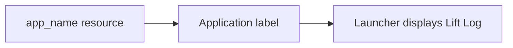
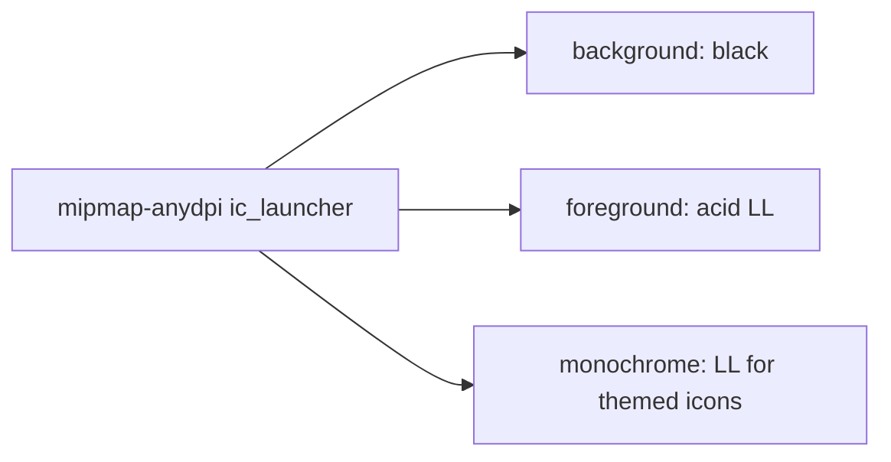

# App Identity
## Inputs And Outputs
- Input: Android application label resolution.
- Output: Lift Log.
- Code: app/src/main/res/values/strings.xml defines app_name; app/src/main/AndroidManifest.xml uses that resource for the application label.
- README.md uses the same product name. The existing application identifier and Gradle root name retain their existing values.

## Launcher Icon
- Input: Launcher icon resolution on Android 8.0 (API 26) and later; minSdk is 26.
- Output: Adaptive icon with acid italic LL on black.
- Code: app/src/main/res/mipmap-anydpi/ic_launcher.xml and ic_launcher_round.xml combine app/src/main/res/drawable/ic_launcher_background.xml, ic_launcher_foreground.xml and ic_launcher_monochrome.xml.
- Geometry: 108 by 108 viewport. Each L is a stem and a foot, sheared by 0.42 (about 23 degrees) and scaled so every point lies within 31 units of the center, inside the 33 unit safe zone.
- Density specific bitmap icons are not used because every supported Android version reads the adaptive icon.

## Example
- Input: Launcher resolves the application label.
- Steps: Read AndroidManifest.xml and resolve app_name.
- Expected result: Lift Log is displayed with the LL icon.

- [Specification](../../specs/branding/10-app-identity.md)
- [Architecture](../../architecture/10-overview.md)
- [Scenarios](../../testing/scenarios/branding/10-app-identity.md)