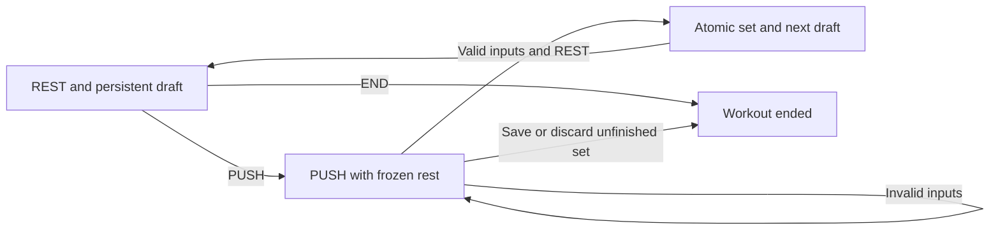

# Recording Roadmap Design

## Recording Core
Source paths below are relative to app/src/main/java/com/example/workouttimer.

| Module or interface | Input | Output and behavior |
| --- | --- | --- |
| data/Workout.kt WorkoutSet and WorkoutSession | Set fields and workout metadata | Immutable local dated workout records |
| SessionDraft restMillis and push | Wall time, monotonic elapsed time, boot count | Growing REST or frozen PUSH duration; reboot falls back to nonnegative wall duration |
| SessionDraft rest | Clock snapshot | Next REST draft with exercise and weight retained and repetitions cleared |
| SetInput valid and restMillis | User text | Bounded valid set fields or parsed seconds and minutes:seconds |
| WorkoutHistory sessions and average | Stored workouts and exact exercise name | Chronological exercise workouts and arithmetic mean repetitions per set |
| data/WorkoutStore.kt get | Application context | One SQLiteOpenHelper repository per process |
| WorkoutStore start and active | Real or test dataset | Existing draft, or new workout and REST draft |
| WorkoutStore saveDraft | Draft and dataset | Persistent inputs and clock snapshot |
| WorkoutStore completeSet | Valid PUSH draft, dataset and keepReps | Atomic set insertion and next REST draft; reps clear unless keepReps, which the overlay uses; rejects stale draft to prevent duplicate saves |
| WorkoutStore end | Dataset | Completed workout with saved sets retained; empty workout removed |
| WorkoutStore sessions | Dataset | Workouts and their sets, ordered by date and start |
| WorkoutStore bootCount | Device settings | Current boot count for monotonic timer recovery |
| WorkoutStore perDay and testMode | Boolean preference | Persistent graph spacing and active dataset |
| WorkoutStore addTestSet | Local date, exercise, kg, repetitions, rest milliseconds | Test set appended to the finished test workout on that date |
| WorkoutStore fillTestData | None | Thirty day range of example records in test storage only |
| WorkoutStore clearTestData | Confirmed UI request | Deletes test drafts, workouts and sets only |
| OverlayService.kt | Persisted draft set from Home | Push and Rest toggle, set saving with the chosen values, total workout time and END handling over other apps |
| ui/SessionActivity.kt | Persisted draft | Full-screen REST and PUSH controls; no longer opened from Home |
| ui/SetRows.kt bindSetRows | WorkoutSet list | Rows numbered separately for each exercise |
| ui/RecordFormat.kt duration and decimal | Milliseconds or decimal value | Localized compact display strings |

SQLite sessions hold local calendar date, start and end timestamps, and a test flag. Sets reference sessions with cascading deletion. Draft payloads are keyed by dataset. Test deletion never queries real sessions. The legacy overlay layout preferences are independent.

## State Transitions
PUSH freezes the preceding rest duration. REST requires exercise, nonnegative weight and positive whole repetitions, saves one set, clears repetitions and starts a new pause. Repeated state buttons are disabled. Back keeps the draft; END in PUSH offers saving the set or discarding only the unfinished set, with cancellation available. END in REST keeps all saved sets.

On resume, SessionActivity rereads the active draft, refreshes any changed fields, and closes an already ended workout screen. This prevents a previously backgrounded screen from replacing newer saved state.

## Representative Scenario
- Input: bcpr at 60 kg, with 90 seconds of REST before PUSH.
- Steps: Tap PUSH, enter 10 repetitions, tap REST, then leave and reopen the session.
- Expected result: One set is stored with 90 seconds of preceding rest; bcpr and 60 remain, repetitions are empty, and the next rest continues.
- Tests: WorkoutTest and WorkoutStoreInstrumentedTest.

- [Specification](../../specs/workout/20-recording-roadmap.md)
- [Architecture](../../architecture/10-overview.md)
- [Scenarios](../../testing/scenarios/workout/20-recording-roadmap.md)
