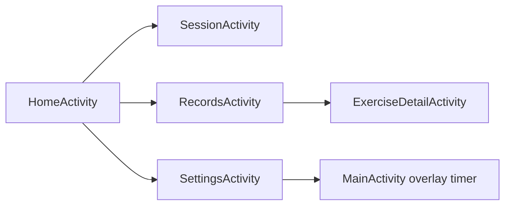

# App Screens Design
Kotlin paths are relative to app/src/main/java/com/example/workouttimer. All screens use Theme.LiftLog and read sample content from ui/PreviewData.kt; none of them writes data.

## Navigation
HomeActivity is the launcher activity. START opens SessionActivity, RECORDS opens RecordsActivity and SETTINGS opens SettingsActivity. A records row opens ExerciseDetailActivity with the exercise name. The overlay timer row in Settings opens the existing MainActivity.

## Public Modules
| Module | Input | Output |
| --- | --- | --- |
| ui/HomeActivity.kt | Launcher intent | Home layout, navigation to Session, Records and Settings |
| ui/SessionActivity.kt | None | Session layout; PUSH and REST switch the state chip, timer text and caption only |
| ui/RecordsActivity.kt | None | One item_exercise_row per sample exercise |
| ui/ExerciseDetailActivity.kt | EXTRA_EXERCISE exercise name | Summary, trend chart and comparison rows for that name |
| ui/SettingsActivity.kt | None | Settings layout; test mode switch shows or hides the test record form |
| ui/TrendChartView.kt | points and spacing | Line chart drawn with Canvas; PER_SESSION places points evenly, PER_DAY places them by dayIndex |
| ui/SetRows.kt | Container and set entries | bindSetRows inflates item_set_row for each entry |
| ui/PreviewData.kt | None | Fixed sample sets, exercises, trend points and comparisons |

## Resources
- Layouts: activity_home, activity_session, activity_records, activity_exercise_detail, activity_settings, item_set_row, item_exercise_row, item_compare_row.
- Values: lift_colors.xml, lift_dimens.xml, lift_styles.xml, lift_strings.xml. Selector colors are in res/color.
- Existing WorkoutActivity, OverlayService and their layouts are unchanged.

## Representative Scenario
- Input: Exercise detail for bcpr with sample trend points on days 0, 3, 10, 13, 14, 20, 23 and 27.
- Steps: Tap Per day in the spacing toggle.
- Expected result: TrendChartView redraws with points placed by day, day ticks along the bottom and the line joining the sessions across empty days.

- [Specification](../../specs/workout/30-app-screens.md)
- [Architecture](../../architecture/10-overview.md)
- [Scenarios](../../testing/scenarios/workout/30-app-screens.md)
