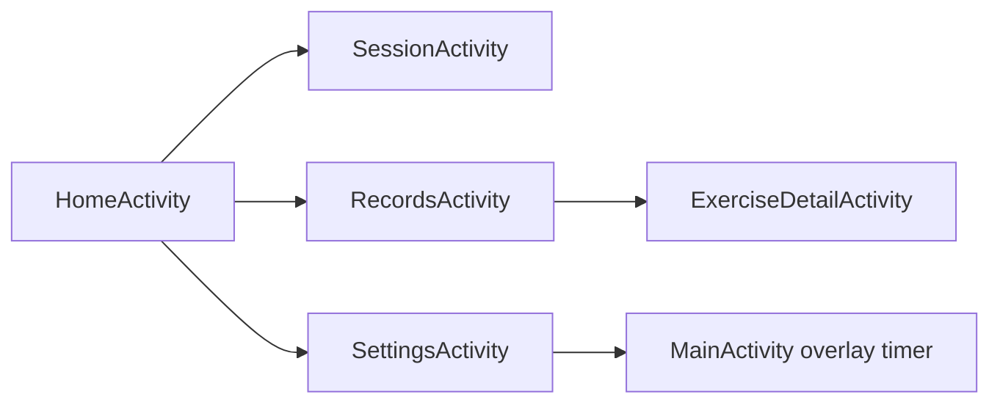

# App Screens Design
Kotlin paths are relative to app/src/main/java/com/example/workouttimer. All screens use Theme.LiftLog. WorkoutStore supplies records to Home, Session, Records and ExerciseDetail; Settings controls persistent graph spacing and the active real or test dataset.

## Navigation
HomeActivity is the launcher activity. START opens SessionActivity, RECORDS opens RecordsActivity and SETTINGS opens SettingsActivity. A records row opens ExerciseDetailActivity with the exercise name. The overlay timer row in Settings opens the existing MainActivity.

## Public Modules
| Module | Input | Output |
| --- | --- | --- |
| ui/HomeActivity.kt | Launcher intent and active dataset | Latest stored summary, START or RESUME, navigation to Session, Records and Settings |
| ui/SessionActivity.kt | Persistent draft | Functional REST and PUSH timing, validation, set saving and END handling |
| ui/RecordsActivity.kt | Active dataset | One item_exercise_row per recorded name with latest date, workout count and mean repetitions |
| ui/ExerciseDetailActivity.kt | EXTRA_EXERCISE exercise name | Actual summary and trend; selected workout compared with its predecessor; selection restored on rotation |
| ui/SettingsActivity.kt | Stored preferences and manual test fields | Persistent spacing and dataset switch, validated test records, background sample generation and confirmed test deletion |
| ui/TrendChartView.kt | points, spacing, selectedIndex and onPointSelected | Canvas line chart; zero point empty state, one point dot, selected point ring and tap callback. PER_SESSION places points evenly; PER_DAY places them by dayIndex |
| ui/SetRows.kt | Container and stored sets | bindSetRows inflates item_set_row, numbering sets per exercise |

## Resources
- Layouts: activity_home, activity_session, activity_records, activity_exercise_detail, activity_settings, item_set_row, item_exercise_row, item_compare_row.
- Values: lift_colors.xml, lift_dimens.xml, lift_styles.xml, lift_strings.xml. Selector colors are in res/color.
- Existing WorkoutActivity, OverlayService and their layouts are unchanged.
- Settings input IDs are input_test_date, input_test_exercise, input_test_weight, input_test_reps and input_test_rest. Dates accept YYYY-MM-DD in 1900 through 2100; rest accepts seconds or minutes:seconds through 24 hours. Test writes run on Dispatchers.IO with controls disabled until completion. Only repetitions clear after a successful manual insert.
- Test mode, chart spacing and real or test drafts survive process restart. A test switch never deletes either dataset; clear test records requires a dialog and preserves real records.

## Representative Scenario
- Input: Stored bcpr workouts on days 0 and 7; latest set has 9 reps and 112 seconds rest, preceding set has 10 reps and 90 seconds rest.
- Steps: Open detail, tap Per day, then select the latest point or workout in the dropdown.
- Expected result: The line spans six empty days; comparison shows 9 versus 10, 1 fewer rep, and 22 seconds more rest. Missing set partners show a dash instead of a fabricated zero. Weights are shown for both sets.

- [Specification](../../specs/workout/30-app-screens.md)
- [Architecture](../../architecture/10-overview.md)
- [Scenarios](../../testing/scenarios/workout/30-app-screens.md)
