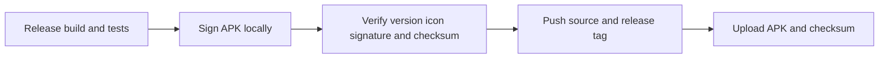

# Release

The first release is 0.1.0 with versionCode 1. Version values are defined in app/build.gradle.kts. Increase versionCode for subsequent releases. Release builds disable debugging and currently do not enable code shrinking.

## Build And Sign

Use JDK 17 and Android SDK 35. Configure local.properties for the installed SDK. Run `./gradlew.bat --no-daemon assembleRelease testReleaseUnitTest`. The release build runs vital lint checks; this does not replace a full lint audit or device testing. Gradle produces app/build/outputs/apk/release/app-release-unsigned.apk. An unsigned APK cannot be installed on Android.

Sign the APK with the dedicated release key using Android SDK Build Tools apksigner. Keep the keystore and credentials outside tracked files. The current certificate uses RSA 3072, SHA256withRSA and a 10000 day validity. Supply passwords through environment variables rather than command arguments containing literal passwords.

Set LIFT_LOG_KEYSTORE to the keystore path, LIFT_LOG_STORE_PASSWORD to the store password, and LIFT_LOG_KEY_PASSWORD to the key password in the current shell. The alias is lift-log. Set ANDROID_HOME to the SDK directory. Create the output directory before signing.

```powershell
& "$env:ANDROID_HOME/build-tools/35.0.0/apksigner.bat" sign --ks $env:LIFT_LOG_KEYSTORE --ks-key-alias lift-log --ks-pass env:LIFT_LOG_STORE_PASSWORD --key-pass env:LIFT_LOG_KEY_PASSWORD --out app/build/outputs/apk/release/lift-log-0.1.0.apk app/build/outputs/apk/release/app-release-unsigned.apk
& "$env:ANDROID_HOME/build-tools/35.0.0/apksigner.bat" verify --verbose --print-certs app/build/outputs/apk/release/lift-log-0.1.0.apk
& "$env:ANDROID_HOME/build-tools/35.0.0/zipalign.exe" -c -P 16 4 app/build/outputs/apk/release/lift-log-0.1.0.apk
& "$env:ANDROID_HOME/build-tools/35.0.0/aapt.exe" dump badging app/build/outputs/apk/release/lift-log-0.1.0.apk
```

Clear password environment variables after signing. Verify versionName, versionCode, application ID, launcher icon and absence of application-debuggable. Confirm v2 and v3 signature verification and calculate the final APK SHA256 checksum.

## Key Backup

Back up both the keystore and its password to durable storage separate from the checkout. Protect backups from unauthorized access. Source code and APK files cannot recover a lost private key or password. Directly distributed updates require the same signing key. Switching from a debug signed installation requires uninstalling it first, which can remove local workout data. This procedure does not uninstall existing apps. Google Play managed signing and key reset procedures are separate from this GitHub distribution workflow.

## Publish

Review outgoing commits and documentation, verify excluded files are untracked, and push master. Create tag 0.1.0 at the release commit. Publish a GitHub release titled 0.1.0 with lift-log-0.1.0.apk and SHA256SUMS.txt. Include changes, Android 8.0 minimum, overlay permission requirements, verification scope and the debug signature migration note. Verify the remote commit, tag and uploaded asset digest after publication. Never upload signing material.



## Example

- Input: Version 0.1.0 source and the backed up Lift Log release key.
- Steps: Build the release variant, sign the unsigned APK, verify it, then publish tag 0.1.0 with the signed APK and checksum.
- Expected result: GitHub hosts an installable release APK without publishing the keystore or password. Later releases signed by the same key can update this installation.

- [Development](10-development.md)
- [Release Scenarios](../testing/scenarios/release/10-publication.md)
- [Android Signing](https://developer.android.com/studio/publish/app-signing)
